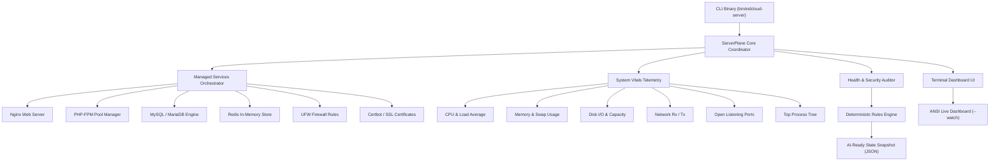

[🇸🇦 العربية](README.ar.md) | [🇬🇧 English](README.md)

# 🎛️ eidcloud-server-plane

> Unified Linux Server Control Plane & Service Manager CLI for Nginx, PHP-FPM, MySQL/MariaDB, Redis, UFW, and SSL Certs in Pure PHP 8.2+. Zero external vendor dependencies.

[](https://github.com/eidcloud/eidcloud-server-plane/releases)
[](https://www.php.net)
[](LICENSE)
[](https://colab.research.google.com/github/eidcloud/eidcloud-server-plane/blob/main/notebooks/quickstart.ipynb)

---

## 📑 Topics
`eidcloud` · `server-control-plane` · `sysadmin` · `server-management` · `nginx-manager` · `php-fpm` · `php8`

---

## 🚀 Overview

**EidCloud Server Plane** is a lightweight, zero-dependency, self-contained server control plane built in pure PHP 8.2+. Engineered for system administrators, DevOps engineers, and autonomous AI infrastructure agents, it consolidates core web stack orchestration, hardware telemetry collection, security auditing, and terminal UI monitoring into a single unified binary.



---

## ✨ Key Capabilities

- **Zero Vendor Dependencies:** 100% pure PHP standard library implementation. Runs out-of-the-box on vanilla PHP 8.2+ without `composer install`.
- **Full Stack Service Management:**
  - **Nginx:** Configuration testing (`nginx -t`), safe reloading, graceful restarting, version detection.
  - **PHP-FPM:** Multi-version detection (`8.4`, `8.3`, `8.2`, `8.1`, `8.0`, `7.4`), pool reloading, configuration validation.
  - **MySQL / MariaDB:** Auto-detection of underlying engine, service lifecycle control, version telemetry.
  - **Redis:** In-memory store lifecycle management and live ping-pong probe verification.
  - **UFW Firewall:** Dynamic rule listing, port opening (`--allow <port>`), port blocking (`--deny <port>`), enable/disable switches.
  - **SSL Certificates:** Automated Certbot integration, certificate expiry countdowns, domain SAN parsing, renewal triggers.
- **Deep Linux Vitals Telemetry:** Real-time `/proc` parsing for CPU load average, RAM/swap pressure, disk mount capacity, network packet counts, open ports (`ss`/`netstat`), and top processes.
- **Deterministic Health & Security Auditing:** Automatically evaluates server metrics against production thresholds and delivers actionable recommendations for OOM risks, storage exhaustion, public DB bindings, and expiring certificates.
- **Interactive Terminal Dashboard:** Rich ANSI dashboard with real-time visual progress bars, live service badges, and continuous monitor mode (`--watch`).
- **AI-Ready JSON Snapshots:** Generates structured, deterministic system state snapshots tailored for LLM agents, auto-remediation bots, and observability pipelines.

---

## 📦 Installation

Clone the repository and add the executable to your path:

```bash
git clone https://github.com/eidcloud/eidcloud-server-plane.git
cd eidcloud-server-plane
chmod +x bin/eidcloud-server
```

*(Optional)* Symlink to `/usr/local/bin`:
```bash
sudo ln -s $(pwd)/bin/eidcloud-server /usr/local/bin/eidcloud-server
```

---

## 🛠️ Usage

### CLI Commands

```bash
# Display Interactive Terminal Dashboard
php bin/eidcloud-server dashboard

# Live Watch Mode (refreshes every 2 seconds)
php bin/eidcloud-server dashboard --watch

# Display Server Vitals & Service Status Overview
php bin/eidcloud-server status

# Export AI-Ready JSON System State Snapshot
php bin/eidcloud-server snapshot > system_snapshot.json

# Perform Automated Health & Security Audit
php bin/eidcloud-server audit

# List Open Listening Ports & Associated Daemons
php bin/eidcloud-server ports

# Test and Reload Nginx
php bin/eidcloud-server nginx --test
php bin/eidcloud-server nginx --reload

# Restart PHP-FPM Service
php bin/eidcloud-server php-fpm --restart

# Ping & Inspect Redis Store
php bin/eidcloud-server redis --ping

# Inspect & Manage Firewall Rules
php bin/eidcloud-server firewall --list
php bin/eidcloud-server firewall --allow 8080

# Inspect SSL Certificates & Renewals
php bin/eidcloud-server ssl
php bin/eidcloud-server ssl --renew
```

### Programmatic PHP Usage

```php
use EidCloud\ServerPlane\ServerPlane;

require_once __DIR__ . '/src/ServerPlane.php';

$plane = new ServerPlane();

// Fetch AI-Ready System Snapshot
$snapshot = $plane->getSnapshot();
echo json_encode($snapshot, JSON_PRETTY_PRINT);

// Check Nginx Status & Reload safely
$nginx = $plane->getService('nginx');
if ($nginx->testConfig()['valid']) {
    $nginx->reload();
}
```

---

## 🧪 Testing

EidCloud Server Plane includes a built-in automated test suite with zero external dependencies:

```bash
php tests/run_tests.php
```

All unit and integration tests include full command mocking, vitals calculation validation, regex parsing checks, and JSON schema validation.

---

## 👤 Author & Maintainer

**Eng. MHD. Shadi AL-Hasan**  
- **Role:** Executive CTO & Enterprise Solutions Architect  
- **Email:** [mhd.shadi.alhasan@gmail.com](mailto:mhd.shadi.alhasan@gmail.com)  
- **Phone / WhatsApp:** [+963934005922](tel:+963934005922)  
- **Location:** Damascus, Syria  
- **GitHub:** [shadialhasan](https://github.com/shadialhasan)  

---

## 📄 License

This project is licensed under the MIT License - see the [LICENSE](LICENSE) file for details.  
Copyright (c) 2026 **MHD. Shadi AL-Hasan**. All rights reserved.
